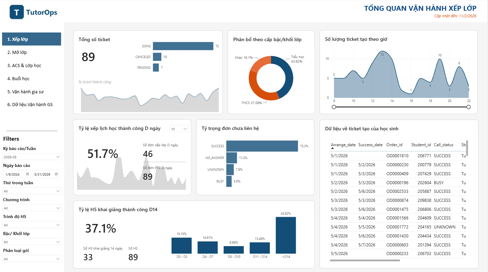
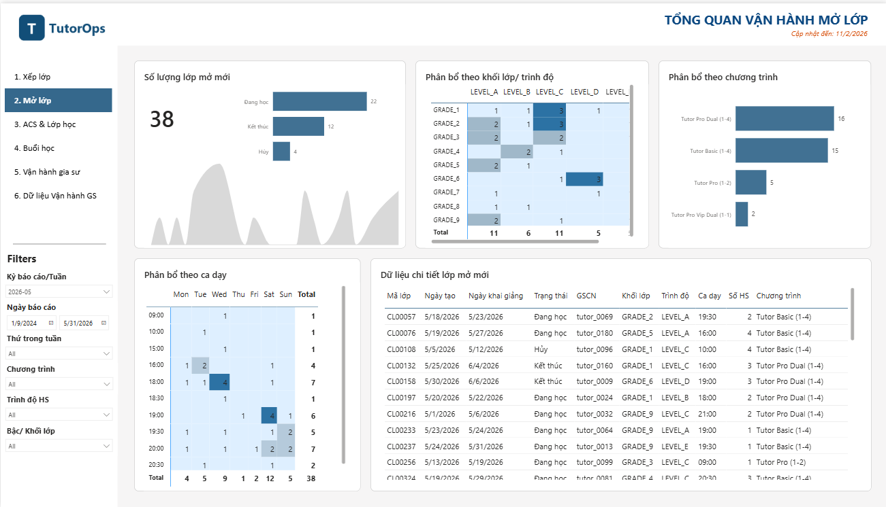
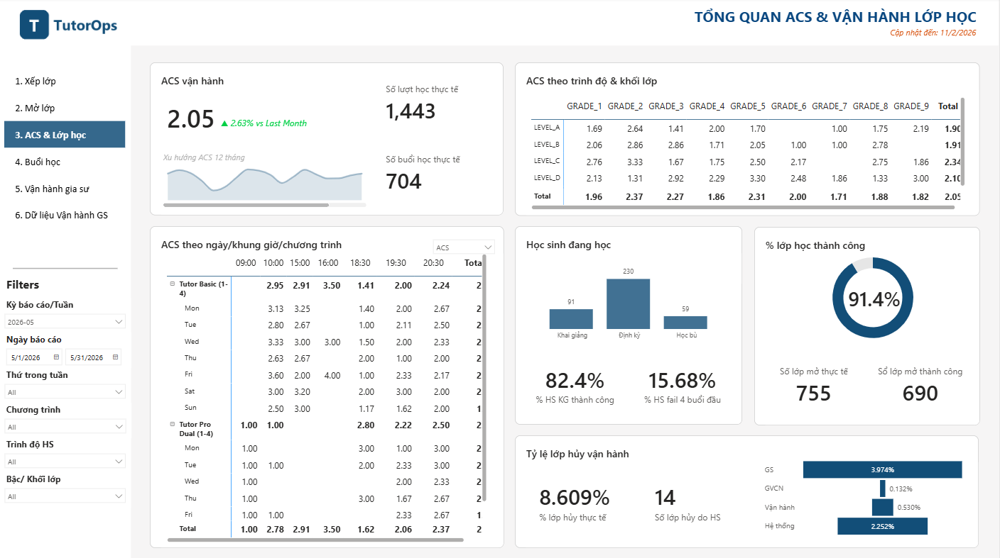
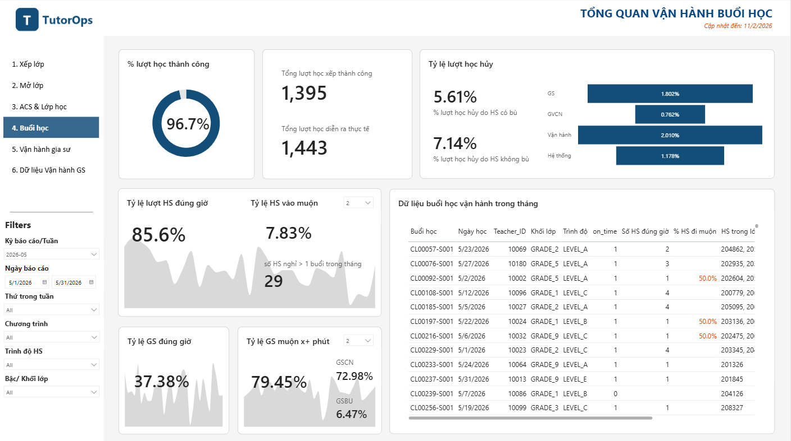
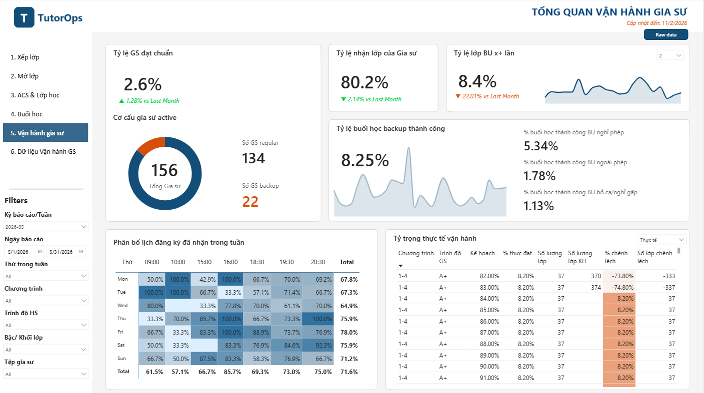
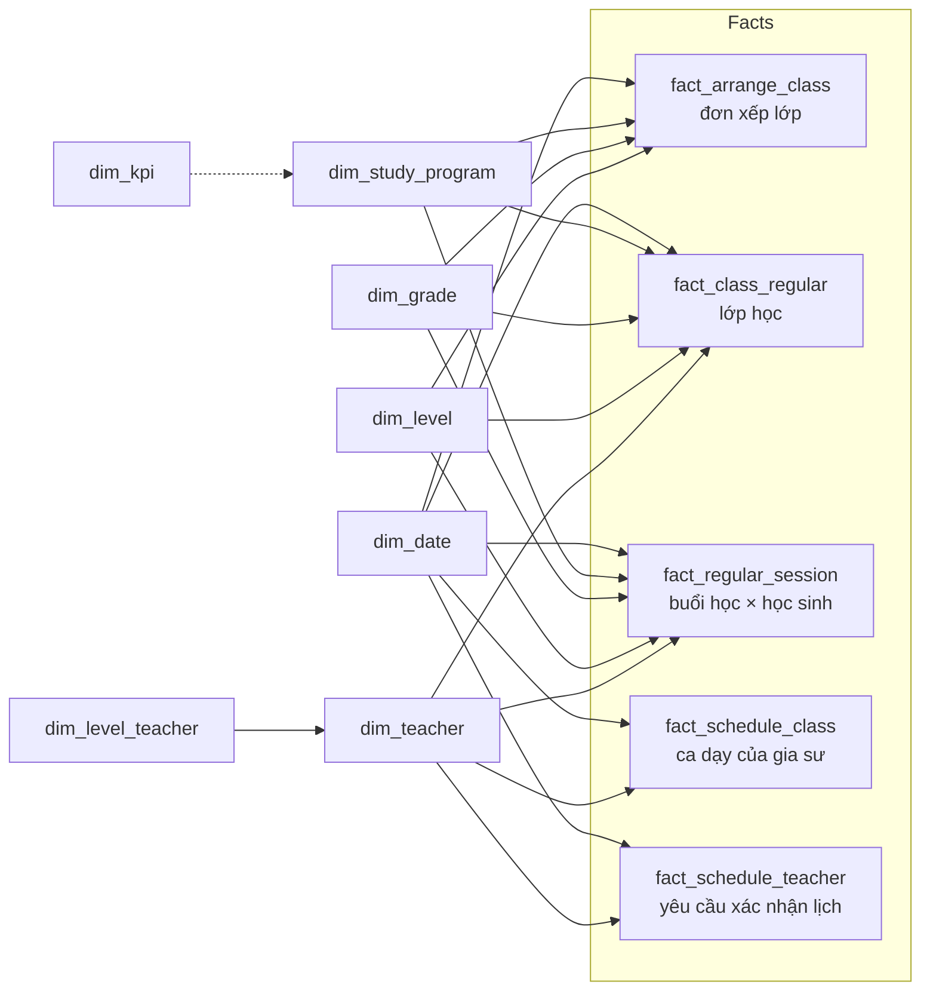

# Tutor Operations – Power BI

> Power BI report for monitoring the daily operations of an **online 1-on-few tutoring service**: class arrangement, class opening, sessions, tutor scheduling and service quality.
> Báo cáo Power BI theo dõi vận hành lớp học gia sư online: xếp lớp, mở lớp, buổi học, lịch gia sư và chất lượng vận hành.


> **Privacy notice.** Đây là phiên bản portfolio đã được ẩn danh hoàn toàn. Mọi dữ liệu trong repo là **dữ liệu giả** do [`scripts/generate_sample_data.py`](scripts/generate_sample_data.py) sinh ra. Tên thương hiệu, nguồn dữ liệu, tên hệ thống nội bộ, tên người và số liệu thật đã được loại bỏ. Xem [docs/sanitization.md](docs/sanitization.md).

---

## 1. Bối cảnh

Một dịch vụ gia sư online tổ chức lớp nhỏ (1-1, 1-2, 1-4 học sinh) theo lịch cố định hằng tuần. Đội vận hành cần trả lời hằng ngày:

- Đơn đăng ký mới có được **xếp lớp kịp thời** không (trong D ngày)?
- Lớp mới có **khai giảng đúng hạn** không? Bao nhiêu lớp bị hủy, vì lý do gì?
- **Buổi học** diễn ra có thành công không? Gia sư và học sinh có vào lớp đúng giờ không?
- Khi gia sư nghỉ, **gia sư backup** có thay thế được không?
- **Gia sư** có đăng ký đủ ca, đủ ca cao điểm, và nhận lịch được giao không?

Trước khi có báo cáo, số liệu được tổng hợp thủ công từ nhiều nguồn (LMS, CRM, Google Sheets). Báo cáo này gom tất cả về một mô hình dữ liệu duy nhất, refresh tự động hằng ngày.

## 2. Các trang báo cáo

| # | Trang | Câu hỏi trả lời | KPI chính |
|---|---|---|---|
| 0 | Nghiệm thu | Tổng hợp KPI vận hành so với mục tiêu | % đạt KPI theo mô hình lớp & cấp gia sư |
| 1 | Xếp lớp | Đơn đăng ký có được xếp lớp nhanh không? | % xếp lớp trong D ngày, % đơn chưa liên hệ, số ticket theo giờ |
| 2 | Mở lớp | Lớp mới mở ra sao? | Số lớp mở mới, phân bổ theo chương trình / khối / ca dạy |
| 3 | ACS & Lớp học | Sĩ số trung bình và sức khỏe lớp học | ACS (Average Class Size), % lớp hủy, % lớp thành công, xu hướng 12 tháng |
| 4 | Buổi học | Chất lượng từng buổi học | % buổi học thành công, % HS/GS đúng giờ, % lượt học hủy |
| 5 | Vận hành gia sư | Năng lực cung ứng gia sư | % GS đạt chuẩn đăng ký ca, % nhận lớp, % backup thành công |
| 6 | Dữ liệu vận hành GS | Bảng chi tiết để đối soát | Raw data lịch, buổi học, đổi chủ nhiệm |
| – | Tooltips (4 trang) | Tooltip chi tiết theo khối lớp, lượt hủy, lớp hủy, lịch | |

*Ảnh chụp với dữ liệu giả:*

| Xếp lớp | Mở lớp |
|---|---|
|  |  |
| **ACS & Lớp học** | **Buổi học** |
|  |  |
| **Vận hành gia sư** | |
|  | |

## 3. Mô hình dữ liệu

Mô hình dạng **star schema** với 5 bảng fact và các bảng dimension dùng chung:



- Chi tiết bảng, cột và quan hệ: [docs/data-model.md](docs/data-model.md)
- Toàn bộ 138 measure DAX: [docs/measures.md](docs/measures.md)

### Một vài kỹ thuật DAX đáng chú ý

- **What-if parameter** (`para_day`, `para_minute`, `para_backup`): người dùng tự chọn ngưỡng "xếp lớp trong D ngày", "muộn quá X phút", "backup từ X lần", và các measure tính lại theo lựa chọn đó.
- **Đánh giá gia sư đạt chuẩn**: `SUMMARIZECOLUMNS` theo gia sư × tuần, kiểm tra đồng thời nhiều điều kiện (≥ 12 ca/tuần, ≥ 10 ca tối, ≥ 3 ca cao điểm, ≥ 2 ca bắt buộc).
- **Field switch** (bảng `switch`): một biểu đồ đổi giữa *Buổi học / Lượt học / ACS* bằng slicer.
- **So sánh kỳ trước**: các measure `vs Last Month` có định dạng ▲ / ▼.

## 4. Chạy thử với dữ liệu giả

Yêu cầu: Power BI Desktop (bản 2024 trở lên, đã bật *Power BI Project (.pbip)*), Python 3.9+ nếu muốn sinh lại dữ liệu.

```bash
git clone https://github.com/duongnt0201/tutor-operations-powerbi.git
cd tutor-operations-powerbi
python scripts/generate_sample_data.py      # tùy chọn: dữ liệu đã có sẵn trong data/sample
```

1. Mở `powerbi/TutorOperations.pbip` bằng Power BI Desktop.
2. **Transform data → Edit parameters**, đặt `SampleDataPath` = đường dẫn tuyệt đối tới thư mục `data/sample/` (có dấu `\` ở cuối).
3. Bấm **Refresh**.

> Một số bảng dùng custom visual **Advanced Grid Table** (bên thứ ba). Repo không phân phối lại file `.pbiviz`. Nếu cần, hãy tải từ trang của tác giả rồi import vào report.

## 5. Tối ưu & bài học

Phân tích model đã tìm ra một số điểm có thể cải thiện về dung lượng, tốc độ refresh và độ an toàn của quan hệ, ví dụ Auto date/time tạo 10 bảng ẩn, calculated column dùng `RANKX` trên bảng fact, và khóa quan hệ khác kiểu dữ liệu. Chi tiết: [docs/optimization.md](docs/optimization.md).

## 6. Cấu trúc repo

```text
tutor-operations-powerbi/
├── powerbi/
│   ├── TutorOperations.pbip
│   ├── TutorOperations.Report/          # PBIR: trang, visual, filter
│   └── TutorOperations.SemanticModel/   # TMDL: bảng, cột, measure, quan hệ
├── data/sample/                         # CSV dữ liệu giả
├── scripts/
│   ├── generate_sample_data.py          # sinh dữ liệu giả theo đúng schema
│   └── build_docs.py                    # sinh docs/ từ TMDL
└── docs/
    ├── data-model.md
    ├── measures.md
    ├── optimization.md
    └── sanitization.md
```

## 7. Tech stack

Power BI Desktop (PBIP / PBIR / TMDL) · DAX · Power Query (M) · SQL · Python

## License

[MIT](LICENSE)
