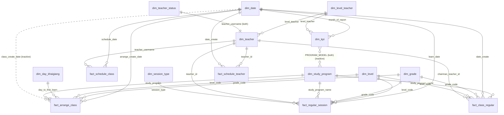

# Data model

> Generated by `scripts/build_docs.py` from the TMDL definition.

## Relationship diagram

## Tables

| Table | Type | Columns | Calculated columns | Measures |
|---|---|---|---|---|
| `A - Measure` | Measure table | 0 | 0 | 134 |
| `dim_date` | Dimension | 8 | 5 | 0 |
| `dim_day_khaigiang` | Dimension | 2 | 0 | 0 |
| `dim_grade` | Dimension | 5 | 0 | 0 |
| `dim_kpi` | Dimension | 4 | 0 | 0 |
| `dim_level` | Dimension | 3 | 0 | 0 |
| `dim_level_teacher` | Dimension | 2 | 0 | 0 |
| `dim_session_type` | Dimension | 3 | 0 | 0 |
| `dim_study_program` | Dimension | 7 | 0 | 0 |
| `dim_tag_student` | Dimension | 3 | 0 | 0 |
| `dim_teacher` | Dimension | 7 | 0 | 0 |
| `dim_teacher_status` | Dimension | 2 | 0 | 0 |
| `fact_arrange_class` | Fact | 24 | 2 | 0 |
| `fact_class_regular` | Fact | 20 | 0 | 0 |
| `fact_regular_session` | Fact | 22 | 3 | 0 |
| `fact_schedule_class` | Fact | 19 | 2 | 0 |
| `fact_schedule_teacher` | Fact | 7 | 0 | 0 |
| `para_backup` | Parameter | 1 | 0 | 1 |
| `para_day` | Parameter | 1 | 0 | 1 |
| `para_minute` | Parameter | 1 | 0 | 1 |
| `para_minute_teacher` | Parameter | 1 | 0 | 1 |
| `switch` | Helper | 4 | 0 | 0 |
| `tab` | Helper | 15 | 0 | 0 |
| `Table` | Helper | 1 | 0 | 0 |

## Columns

### dim_date

| Column | Type | Calculated |
|---|---|---|
| `report_date` | dateTime |  |
| `month_year` | string |  |
| `year` | int64 |  |
| `quarter` | string |  |
| `month` | int64 |  |
| `month_name` | string |  |
| `start_of_month` | dateTime |  |
| `month_year_sort` | int64 |  |
| `date_filter` | - | yes |
| `week_of_year` | - | yes |
| `week_of_month` | - | yes |
| `day_of_week` | - | yes |
| `week_day` | - | yes |

### dim_day_khaigiang

| Column | Type | Calculated |
|---|---|---|
| `id` | - |  |
| `day_to_first_learn` | - |  |

### dim_grade

| Column | Type | Calculated |
|---|---|---|
| `code` | string |  |
| `name` | string |  |
| `sort` | int64 |  |
| `level` | string |  |
| `level_sort` | int64 |  |

### dim_kpi

| Column | Type | Calculated |
|---|---|---|
| `program_model` | string |  |
| `level_teacher` | string |  |
| `KPI` | double |  |
| `month_of_report` | dateTime |  |

### dim_level

| Column | Type | Calculated |
|---|---|---|
| `CODE` | string |  |
| `NAME` | string |  |
| `VALUE` | int64 |  |

### dim_level_teacher

| Column | Type | Calculated |
|---|---|---|
| `level_teacher` | - |  |
| `id` | - |  |

### dim_session_type

| Column | Type | Calculated |
|---|---|---|
| `session_type` | - |  |
| `name` | - |  |
| `id` | - |  |

### dim_study_program

| Column | Type | Calculated |
|---|---|---|
| `STUDY_PROGRAM_NAME` | string |  |
| `MAX_STUDENT_IN_CLASS` | int64 |  |
| `STUDY_PROGRAM_CODE` | string |  |
| `TYPE` | string |  |
| `PRODUCT_TYPE_CODE` | string |  |
| `SESSIONS_PER_WEEK` | int64 |  |
| `PROGRAM_MODEL` | string |  |

### dim_tag_student

| Column | Type | Calculated |
|---|---|---|
| `tag_student` | - |  |
| `name` | - |  |
| `id` | - |  |

### dim_teacher

| Column | Type | Calculated |
|---|---|---|
| `teacher_id` | string |  |
| `teacher_username` | string |  |
| `full_name` | string |  |
| `gender` | string |  |
| `region` | string |  |
| `phone` | string |  |
| `level_teacher` | string |  |

### dim_teacher_status

| Column | Type | Calculated |
|---|---|---|
| `teacher_code` | string |  |
| `work_status` | string |  |

### fact_arrange_class

| Column | Type | Calculated |
|---|---|---|
| `task_arrange_class_id` | string |  |
| `class_code` | string |  |
| `arrange_status` | string |  |
| `arrange_class_method` | string |  |
| `arrange_create_date` | dateTime |  |
| `arrange_success_date` | dateTime |  |
| `arrange_type` | string |  |
| `order_id` | string |  |
| `ptc_date` | dateTime |  |
| `first_learn_date` | dateTime |  |
| `student_id` | double |  |
| `grade_program` | string |  |
| `grade_code` | string |  |
| `level_code` | string |  |
| `phone` | string |  |
| `day_to_assigned_arrange` | - | yes |
| `day_to_first_learn` | - | yes |
| `arrange_create_hour` | int64 |  |
| `day_of_week` | string |  |
| `start_time` | string |  |
| `study_program` | string |  |
| `class_create_date` | dateTime |  |
| `call_status` | string |  |
| `package_name` | string |  |
| `order_type` | string |  |
| `new_package_category` | string |  |

### fact_class_regular

| Column | Type | Calculated |
|---|---|---|
| `class_code` | string |  |
| `date_create` | dateTime |  |
| `class_status` | string |  |
| `number_of_students` | int64 |  |
| `grade_code` | string |  |
| `level_code` | string |  |
| `study_program_name` | string |  |
| `start_time` | string |  |
| `chairman_teacher_username` | string |  |
| `before_chairman_teacher_username` | string |  |
| `before_chairman_teacher_id` | double |  |
| `learn_date` | dateTime |  |
| `terminated_teacher_id` | double |  |
| `terminated_type` | string |  |
| `terminated_create_date` | dateTime |  |
| `has_change_teacher` | double |  |
| `has_terminated_ticket` | double |  |
| `chairman_teacher_order` | double |  |
| `chairman_teacher_id` | double |  |
| `class_openning_date` | dateTime |  |

### fact_regular_session

| Column | Type | Calculated |
|---|---|---|
| `class_code` | string |  |
| `student_id` | int64 |  |
| `learn_date` | dateTime |  |
| `is_student_on_time` | int64 |  |
| `student_early_in_minutes` | double |  |
| `class_session_code` | string |  |
| `session_number` | int64 |  |
| `session_status` | string |  |
| `student_status` | string |  |
| `session_type` | string |  |
| `is_success_session` | int64 |  |
| `is_teacher_on_time` | int64 |  |
| `teacher_early_in_minutes` | double |  |
| `learn_month` | - | yes |
| `grade_code` | string |  |
| `teacher_id` | double |  |
| `level_code` | string |  |
| `chairman_teacher_id` | string |  |
| `is_backup` | double |  |
| `study_program_name` | string |  |
| `start_time` | string |  |
| `session_number_type` | - | yes |
| `absence_type` | string |  |
| `absence_status` | string |  |
| `chairman_teacher_username` | - | yes |

### fact_schedule_class

| Column | Type | Calculated |
|---|---|---|
| `id` | string |  |
| `month_of_report` | dateTime |  |
| `schedule_date` | dateTime |  |
| `assigned_date` | dateTime |  |
| `schedule_status` | string |  |
| `day_of_week` | string |  |
| `start_time` | string |  |
| `end_time` | string |  |
| `is_schedule_required` | int64 |  |
| `schedule_type` | string |  |
| `teacher_id` | int64 |  |
| `teacher_username` | string |  |
| `tutor_group` | string |  |
| `monthly_teacher_status` | string |  |
| `session_code` | string |  |
| `class_code` | string |  |
| `weekofmonth` | - | yes |
| `evening_shift` | int64 |  |
| `peak_shift` | int64 |  |
| `is_assigned` | - | yes |
| `date_create` | dateTime |  |

### fact_schedule_teacher

| Column | Type | Calculated |
|---|---|---|
| `id` | string |  |
| `teacher_id` | int64 |  |
| `status` | string |  |
| `tutor_group` | string |  |
| `date_create` | dateTime |  |
| `teacher_status` | string |  |
| `code` | string |  |

### para_backup

| Column | Type | Calculated |
|---|---|---|
| `para_backup` | - |  |

### para_day

| Column | Type | Calculated |
|---|---|---|
| `para_day` | - |  |

### para_minute

| Column | Type | Calculated |
|---|---|---|
| `para_minute` | - |  |

### para_minute_teacher

| Column | Type | Calculated |
|---|---|---|
| `para_minute_teacher` | - |  |

### switch

| Column | Type | Calculated |
|---|---|---|
| `id` | - |  |
| `name` | - |  |
| `switch` | - |  |
| `kpi` | - |  |

### tab

| Column | Type | Calculated |
|---|---|---|
| `ID` | - |  |
| `Name` | - |  |
| `Model` | - |  |
| `Relationship` | - |  |
| `IsActive` | - |  |
| `CrossFilteringBehavior` | - |  |
| `RelyOnReferentialIntegrity` | - |  |
| `FromTable` | - |  |
| `FromColumn` | - |  |
| `FromCardinality` | - |  |
| `ToTable` | - |  |
| `ToColumn` | - |  |
| `ToCardinality` | - |  |
| `State` | - |  |
| `SecurityFilteringBehavior` | - |  |

### Table

| Column | Type | Calculated |
|---|---|---|
| `Column` | - |  |

## Relationships

| From | To | Cardinality | Cross filter | Active |
|---|---|---|---|---|
| `fact_regular_session.learn_date` | `dim_date.report_date` | many:one | single | yes |
| `fact_arrange_class.arrange_create_date` | `dim_date.report_date` | many:one | single | yes |
| `fact_arrange_class.grade_code` | `dim_grade.code` | many:one | single | yes |
| `fact_arrange_class.level_code` | `dim_level.CODE` | many:one | single | yes |
| `fact_schedule_class.schedule_date` | `dim_date.report_date` | many:one | single | yes |
| `fact_arrange_class.day_to_first_learn` | `dim_day_khaigiang.day_to_first_learn` | many:one | single | yes |
| `fact_arrange_class.study_program` | `dim_study_program.STUDY_PROGRAM_NAME` | many:one | single | yes |
| `fact_arrange_class.class_create_date` | `dim_date.report_date` | many:one | single | no |
| `fact_regular_session.level_code` | `dim_level.CODE` | many:one | single | yes |
| `fact_regular_session.grade_code` | `dim_grade.code` | many:one | single | yes |
| `fact_regular_session.study_program_name` | `dim_study_program.STUDY_PROGRAM_NAME` | many:one | single | yes |
| `fact_schedule_class.teacher_username` | `dim_teacher.teacher_username` | many:one | single | yes |
| `fact_regular_session.teacher_id` | `dim_teacher.teacher_id` | many:one | single | yes |
| `fact_regular_session.session_type` | `dim_session_type.session_type` | many:one | single | yes |
| `fact_class_regular.study_program_name` | `dim_study_program.STUDY_PROGRAM_NAME` | many:one | single | yes |
| `fact_class_regular.date_create` | `dim_date.report_date` | many:one | single | yes |
| `fact_class_regular.grade_code` | `dim_grade.code` | many:one | single | yes |
| `fact_class_regular.level_code` | `dim_level.CODE` | many:one | single | yes |
| `fact_class_regular.chairman_teacher_id` | `dim_teacher.teacher_id` | many:one | single | yes |
| `dim_study_program.PROGRAM_MODEL` | `dim_kpi.program_model` | many:many | both | no |
| `dim_kpi.month_of_report` | `dim_date.report_date` | many:one | single | yes |
| `dim_teacher.level_teacher` | `dim_level_teacher.level_teacher` | many:one | single | yes |
| `dim_kpi.level_teacher` | `dim_level_teacher.level_teacher` | many:one | single | yes |
| `dim_teacher.teacher_username` | `dim_teacher_status.teacher_code` | one:one | both | yes |
| `fact_schedule_teacher.teacher_id` | `dim_teacher.teacher_id` | many:one | single | yes |
| `fact_schedule_teacher.date_create` | `dim_date.report_date` | many:one | single | yes |
